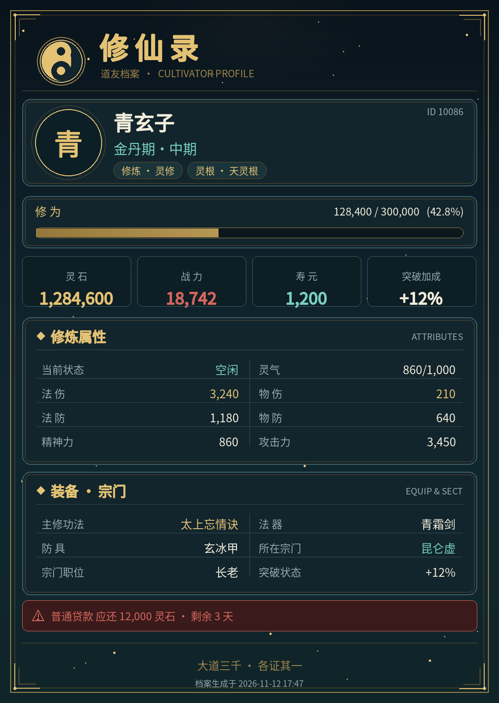

# AstrBot 插件：模拟修仙 v2

<p align="center">
  
</p>

> **版本:** v3.3.4  
> **许可证:** AGPL-3.0  
> **作者:** xiaojuwa  
> **基于:** [nonebot_plugin_xiuxian_2](https://github.com/xiuxian-2/nonebot_plugin_xiuxian_2) (部分借鉴与重构)

一款为 AstrBot 设计的、功能丰富的放置类修仙游戏插件。让你在聊天群中体验从凡人到大能的修行之路，工作摸鱼、畅聊吹水的同时亦可得道飞升！

---

## 🌟 特色功能

### 核心玩法
| 系统 | 说明 |
|------|------|
| **境界修炼** | 练气→筑基→金丹→元婴→化神→炼虚→合体→大乘→渡劫，九大境界逐步突破 |
| **战斗系统** | HP/MP/ATK/暴击/防御 真实计算，支持 PVP（切磋/决斗）和 PVE |
| **宗门系统** | 创建/加入宗门，职位管理，宗门建设与捐献 |
| **世界Boss** | 全服Boss降临，多人合力讨伐，按伤害排名瓜分奖励 |
| **秘境探索** | 挂机式秘境探索，获取丰厚修为与灵石 |
| **历练系统** | 离线挂机获取收益，短途/中途/长途三种时长 |
| **炼丹系统** | 收集材料炼制丹药，提升修为或增加属性 |
| **传承系统** | 传承挑战争夺Buff加成，传承排行榜竞技 |

### 独有系统
| 系统 | 说明 |
|------|------|
| **🏔️ 洞天福地** | 个人修炼空间，5档洞天可选，持续产出灵石和修为 |
| **🌾 灵田种植** | 开垦灵田种植灵草，5种灵草不同收益周期 |
| **💕 双修系统** | 与他人双修互增10%修为，1小时冷却 |
| **👁️ 天地灵眼** | 抢占灵眼持续获益，PVP资源争夺玩法 |

---

## 📜 指令大全

### 📖 入门 & 基础
| 指令 | 说明 |
|------|------|
| `我要修仙 [灵修/体修]` | 创建角色，灵修擅法术，体修擅肉身 |
| `我的信息` | 显示境界、修为、战力、装备等完整面板 |
| `签到` | 每日领取灵石(50-200)和修为奖励 |
| `改道号 <名称>` | 修改你的仙道称号 |
| `弃道重修 [确认]` | 删除角色并清空数据，7天内仅可执行一次，需追加“确认” |

### 🧘 修炼突破
| 指令 | 说明 |
|------|------|
| `闭关` | 开始闭关修炼，离线也可积累修为 |
| `出关` | 结算闭关时间，获取对应修为 |
| `突破信息` | 查看当前境界突破所需修为、成功率、风险 |
| `突破 [丹药名]` | 尝试突破，可服用丹药增加成功率 |

### 🎒 装备丹药
| 指令 | 说明 |
|------|------|
| `我的装备` | 显示已装备的武器/防具/心法 |
| `装备 <名>` | 从储物戒装备到身上 |
| `卸下 <名>` | 卸下装备放回储物戒 |
| `丹药背包` | 查看拥有的丹药及效果 |
| `服用丹药 <名>` | 使用丹药获得增益 |

### 🏪 商店系统
| 指令 | 说明 |
|------|------|
| `丹阁` | 丹药专卖(破境丹/修为丹/功能丹) |
| `器阁` | 装备专卖(武器/防具/饰品) |
| `百宝阁` | 综合商店(功法/材料/杂物) |
| `购买 <物品名> [数量]` | 从当前商店购买物品 |
| `物品信息 <名称>` | 查看任意上架物品/丹药的具体效果与获取途径 |
| `储物戒` | 查看你的储物空间和物品（分类显示） |
| `存入 <物品名> [数量]` | 存入物品到储物戒 |
| `取出 <物品名> [数量]` | 从储物戒取出物品 |
| `搜索物品 <关键词>` | 模糊搜索储物戒物品 |
| `取出所有 <分类>` | 批量取出指定分类（材料/装备/功法/其他） |
| `更换储物戒 <名称>` | 升级储物戒（需支付灵石） |
| `赠予 <@某人> <物品> [数量]` | 将物品赠送给其他玩家 |

### 🏦 灵石银行
年利率5%，每日复利

| 指令 | 说明 |
|------|------|
| `银行` | 查看存款余额和待领利息 |
| `存灵石 <数量>` | 存入灵石，开始计息 |
| `取灵石 <数量>` | 取出存款 |
| `领取利息` | 每日可领一次利息 |

### 📜 悬赏任务
| 指令 | 说明 |
|------|------|
| `悬赏令` | 查看当期多难度悬赏（显示风险/目标/奖励/说明） |
| `接取悬赏 <编号>` | 接取指定任务，限时内完成对应目标 |
| `悬赏状态` | 查看任务进度、剩余时间和奖励 |
| `完成悬赏` | 提交任务领取灵石/修为/掉落 |
| `放弃悬赏` | 取消当前任务（触发冷却） |
> 悬赏进度通过对应标签的活动累计：巡山/云游/猎魔等历练路线会提供不同“冒险标签”，秘境探索也能推进探索类悬赏。

### 🏛️ 宗门系统
| 指令 | 说明 |
|------|------|
| `创建宗门 <名>` | 消耗灵石创建宗门 |
| `加入宗门 <名>` | 加入已有宗门 |
| `我的宗门` | 查看宗门信息和成员 |
| `宗门列表` | 查看所有宗门排名 |
| `退出宗门` | 退出当前宗门 |
| `宗门捐献 <数量>` | 捐献灵石增加宗门建设度 |

### ⚔️ 战斗竞技
| 指令 | 说明 |
|------|------|
| `切磋 <@某人>` | 友好切磋，无损失 |
| `决斗 <@某人>` | 生死之战，败者损修为 |
| `世界Boss` | 查看Boss信息和血量 |
| `挑战Boss` | 挑战Boss获取丰厚奖励 |
| `传承挑战 <@某人>` | 争夺对方传承加成 |
| `传承排行` | 查看传承榜 |

### 📊 排行榜
| 指令 | 说明 |
|------|------|
| `境界排行` | 查看境界排行榜 |
| `战力排行` | 查看战力排行榜 |
| `灵石排行` | 查看灵石排行榜 |
| `宗门排行` | 查看宗门排行榜 |

### 🚶 历练系统
| 指令 | 说明 |
|------|------|
| `开始历练 <路线名>` | 巡山问道 / 云游四方 / 猎魔肃清 / 九死一生 |
| `历练状态` | 查看当前路线进度与剩余时间 |
| `完成历练` | 领取路线奖励与奇遇掉落 |
| `历练信息` | 查看路线风险、可玩性与收益说明 |

### 🌀 秘境探索
| 指令 | 说明 |
|------|------|
| `秘境列表` | 查看可探索秘境及奖励 |
| `探索秘境 <ID>` | 进入秘境探险 |
| `完成探索` | 领取秘境奖励 |
| `退出秘境` | 放弃探索(无奖励) |

### 🔥 炼丹系统
| 指令 | 说明 |
|------|------|
| `丹药配方` | 查看炼丹配方及成功率 |
| `炼丹 <配方ID>` | 炼制丹药（成功后存入丹药背包） |

### ✨ 传承系统
| 指令 | 说明 |
|------|------|
| `传承信息` | 查看传承给你的属性加成 |

### 🏔️ 洞天福地
| 指令 | 说明 |
|------|------|
| `我的洞天` | 查看洞天信息和待收取收益 |
| `购买洞天 <1-5>` | 1:小洞天 2:中洞天 3:大洞天 4:福地 5:洞天福地 |
| `升级洞天` | 提升洞天等级增加收益 |
| `洞天收取` | 收取灵石和修为产出 |

**洞天类型：**
| 类型 | 价格 | 修炼加成 |
|------|------|----------|
| 小洞天 | 10,000灵石 | +5% |
| 中洞天 | 50,000灵石 | +10% |
| 大洞天 | 200,000灵石 | +20% |
| 福地 | 500,000灵石 | +30% |
| 洞天福地 | 1,000,000灵石 | +50% |

### 🌾 灵田种植
| 指令 | 说明 |
|------|------|
| `我的灵田` | 查看灵田和种植情况 |
| `开垦灵田` | 花费灵石开垦灵田 |
| `种植 <灵草名>` | 种植灵草 |
| `收获` | 收获成熟的灵草获取修为 |
| `升级灵田` | 增加种植格数 |

**可种植灵草：**
| 灵草 | 成熟时间 | 修为收益 |
|------|----------|----------|
| 灵草 | 1小时 | +500 |
| 血灵草 | 2小时 | +1,500 |
| 冰心草 | 4小时 | +4,000 |
| 火焰花 | 8小时 | +10,000 |
| 九叶灵芝 | 24小时 | +30,000 |

### 💕 双修系统
| 指令 | 说明 |
|------|------|
| `双修 <@某人>` | 向对方发起双修请求 |
| `接受双修` | 接受双修，双方各获10%修为 |
| `拒绝双修` | 拒绝对方请求 |

### 🗡️ 弃道重修
| 指令 | 说明 |
|------|------|
| `弃道重修` | 展示重修提示，需处于空闲且无贷款状态 |
| `弃道重修 确认` | 立即删除角色数据并进入7天冷却期 |

> 重修可用于测试突破死亡逻辑或重新投胎，但冷却未结束前不可再次使用，且需要重新发送「我要修仙」创建角色。

### 👁️ 天地灵眼
| 指令 | 说明 |
|------|------|
| `灵眼信息` | 查看灵眼及可抢占列表 |
| `抢占灵眼 <ID>` | 占据无主灵眼 |
| `灵眼收取` | 收取灵眼修为产出 |
| `释放灵眼` | 释放已占据的灵眼 |

---

## 🎁 道具与丹药手册

| 类别 | 示例 | 作用 | 获取方式 |
|------|------|------|------|
| 破境丹 | 筑基丹、凝婴丹、化神丹 | 直接提升指定境界的突破成功率，部分丹药可将总成功率拉满 | 丹阁刷新、秘境稀有掉落 |
| 修为丹 | 炼气丹、玄灵丹、九转灵丹 | 立即增加修为值（200-10万+），全部存入丹药背包可随时服用 | 丹阁、炼丹系统、历练/秘境结算奖励 |
| 功能丹/灵丹 | 修炼加速丹、力量丹、灵智丹、回生丹 | 包含临时修炼倍率、永久属性增减、复活、定魂护盾等特殊效果 | 丹阁稀有刷新、Boss与高阶秘境掉落 |
| 百宝丹药（即时消耗） | 一品气血丹、三品凝神增益丹 | 购买后立即恢复气血/灵气、增减属性或短暂提升突破成功率 | 百宝阁限量出售（无法存入背包） |
| 材料 | 灵草、玄铁、星辰石、天材地宝 | 炼丹配方、悬赏任务、装备升级所需的基础资源 | 历练、秘境、悬赏、世界Boss掉落，灵田收获可持续产出灵草 |
| 法器/功法 | 青锋剑、玄铁甲、焚天诀、他化自在大法 | 装备/心法提供物伤、法伤、防御与修炼倍率等长期加成 | 器阁 / 百宝阁刷新，高级 Boss 亦可掉落稀有法器 |

💡 使用 `物品信息 <名称>` 可随时查询任意上架物品或丹药的详细效果与推荐获取途径。

---

## ⚙️ 配置说明

插件首次运行后，将在 `data/plugins/astrbot_plugin_monixiuxian2/config/` 目录下自动生成默认配置文件：

| 配置文件 | 作用 |
|---------|------|
| `sect_config.json` | 宗门创建消耗、职位权限、任务奖励 |
| `boss_config.json` | Boss 属性成长曲线、生成间隔 |
| `rift_config.json` | 秘境名称、等级要求、探索时长、奖励池 |
| `alchemy_config.json` | 丹药配方、材料消耗、成功率计算 |

**注意**：修改配置后需重启 AstrBot 生效。

---

## 🖼️ 个人信息图片卡片（内置·开箱即用）

发送 `我的信息` 时会生成一张国风「道友档案」卡片，效果预览：



**旧版说明里那个「卡图资源包」下载地址已无任何资源**，且依赖 `data/xiuxian/` 下的
`back.png` / `line2~4.png` / `font.ttf` 才能出图，缺素材时只能画出灰底豆腐块，
因此该功能实际上长期处于禁用状态。现已彻底重构：

| 项目 | 说明 |
|------|------|
| 无需下载素材 | 卡片全部由插件用 Pillow 现场绘制（渐变、云纹、太极印、回纹边框、修为进度条） |
| 无需配置字体 | 内置精简中文字体 `assets/fonts/XiuXianSans.otf`（GB2312 常用字 + 全部游戏专有名词，约 3.4MB）；也会自动探测系统中文字体作为备选 |
| 依赖 | 仅 `Pillow>=9.0.0`（`requirements.txt` 已声明） |
| 开关 | 配置项 `ENABLE_IMAGE_CARD`，默认开启；关闭后使用纯文本面板 |
| 自动降级 | 缺少 Pillow 或任何环节渲染失败时，自动回退到完整文本面板，不会发送乱码图片 |

> 卡片内容包含道号、境界、修为进度、灵石/战力/寿元、修炼属性、装备、
> 宗门职位与贷款提醒，信息量与此前的文本面板一致。

---

## 🛠️ 安装与部署

1. 确保已安装 AstrBot
2. 将插件文件夹放入 `data/plugins/` 目录
3. 安装依赖：`pip install -r requirements.txt`
4. 在 AstrBot 控制台启用插件
5. 发送 `我要修仙` 开始体验！

---

## 📁 项目结构

```
astrbot_plugin_monixiuxian2/
├── main.py              # 插件入口
├── models.py            # 数据模型
├── config_manager.py    # 配置管理
├── handlers/            # 指令处理器
│   ├── player_handler.py        # 玩家基础
│   ├── breakthrough_handler.py  # 突破系统
│   ├── combat_handlers.py       # 战斗系统
│   ├── sect_handlers.py         # 宗门系统
│   ├── boss_handlers.py         # Boss系统
│   ├── rift_handlers.py         # 秘境系统
│   ├── adventure_handlers.py    # 历练系统
│   ├── alchemy_handlers.py      # 炼丹系统
│   ├── bank_handlers.py         # 银行系统
│   ├── bounty_handlers.py       # 悬赏系统
│   ├── shop_handler.py          # 商店系统
│   ├── blessed_land_handlers.py # 洞天福地
│   ├── spirit_farm_handlers.py  # 灵田系统
│   ├── spirit_eye_handlers.py   # 灵眼系统
│   └── dual_cultivation_handlers.py # 双修系统
├── managers/            # 业务逻辑管理器
├── config/              # 配置文件
├── data/                # 数据文件
└── utils/               # 工具函数
```

---

## 🤝 致谢

- **原版参考**: [NoneBot-Plugin-Xiuxian-2](https://github.com/xiuxian-2/nonebot_plugin_xiuxian_2)
- **原 AstrBot 插件维护者**: [linjianyan0229](https://github.com/linjianyan0229)

---

## 📝 更新日志

### v3.3.4 - 修复「道具与实际使用不符」（商店道具购买失败）

**🐛 问题现象**
- 丹药 / 材料 / 法器 / 功法 四大类共 71 个 `items.json` 道具（含帮助里宣传的
  太上感应篇 / 混元一气幡 / 万年温玉 / 九转还魂丹 等），在商店列表里看得见、
  `/物品信息` 也查得到，但**一买就提示「未知的物品类型：丹药/材料/法器/功法」**，
  扣费事务回滚、道具无法发放。

**🔍 根因**
- `items.json` 使用的是中文类型，而 `ShopManager._get_all_shop_items`（生成商店库存）
  直接把中文类型写进库存；展示路径（`get_all_items_for_display`）与查询路径
  （`find_item_by_name`）却都调用了 `_map_legacy_item_type` 做映射。
- 结果：购买时 `_grant_purchased_item` 从库存读回的是中文类型，只认英文类型的
  发放逻辑全部落入「未知的物品类型」分支而失败。
- v3.3.2 重构时曾把中文分支误判为「死分支」删除，放大了该问题。

**✅ 修复**
- `core/shop_manager.py`：生成商店库存时对 `items.json` 道具统一调用
  `_map_legacy_item_type`，与展示 / 查询路径对齐。
- `handlers/shop_handler.py`：新增 `_normalize_item_type` 兜底归一化，
  **兼容升级前已写入数据库的旧库存**（老存档无需重置即可正常购买）。
- 新增回归测试 `tests/test_item_type_consistency.py`（4 项），
  覆盖「全部道具类型可发放 / 中文类型完整映射 / 旧库存兜底 / 新商品可购买」。

> 购买价格、折扣、限购、冷却、回执等行为均保持不变。

### v3.3.3 - 新增「限定阁购买」指令格式

**🛒 购买指令升级（`handlers/shop_handler.py` / `main.py`）**
- 新增指令格式：`<阁> 购买 <物品> [数量]`，例如 `/丹阁 购买 炼气丹 1`
  - 语义上等价于「先进入某阁、再购买该阁物品」，购买时**只在该阁内查找**物品，避免跨阁重名歧义
  - 三个阁命令（丹阁 / 器阁 / 百宝阁）现可携带参数：参数为「购买 …」时进入限定阁购买，否则照常展示该阁列表
  - 原有全局购买 `/购买 <物品> [数量>` 仍保留（跨所有阁查找）
- 关键实现：框架 `filter.command` 的普通 `str` 参数只接收首词，故购买解析改为直接从 `event.get_message_str()` 提取「购买」之后的 `<物品> [数量]`，不依赖参数传递；并关闭原始消息兜底，避免 `/丹阁 购买 …` 被误当成物品名
- 抽取 `_purchase_core`（购买核心）与 `_extract_buy_rest`（从原始消息提取购买内容）为可复用方法，全局购买与限定阁购买共用同一套冷却 / 限购 / 会员折扣 / 事务 / 回执逻辑
- 帮助指令（`修仙帮助`）同步补充新格式说明与示例

### v3.3.2 - 帮助指令对齐 · 购买代码重构优化

**📖 帮助指令更新**
- `修仙帮助` 指令大全版本号对齐至 v3.3.2，并补充 v3.3.1 新增商品（裂空神枪/九霄雷符/玄黄丹鼎/太上感应篇/混元一气幡/万年温玉/九转还魂丹/化仙丹 等）的提示

**⚡ 购买代码优化（`handlers/shop_handler.py`）**
- 抽取 `_parse_buy_target` 静态方法，统一解析「物品名 + 数量」（兼容全角、`x10` 写法与原始消息兜底），消除散落的重复解析逻辑
- 抽取 `_grant_purchased_item` 分发方法，将原本 5 个 `if/elif` 分支（武器/丹药/旧丹/材料/未知）合并为按类型派发，去除中文「功法」残留死分支，可读性显著提升
- 去除事务内与事务外**重复的灵石二次校验**，改为「事务内重新读取玩家 + 单一权威校验」，逻辑等价但代码更精简
- 将循环内的 `import time` 上提到模块级，避免反复导入

> 回执格式与既有购买行为保持不变，对玩家无感知影响。

### v3.3.1 - 商店购买机制升级（冷却/限购/会员折扣/回执优化/物品扩充）

**🛒 购买流程增强**

- **购买回执优化**：购买成功后回执新增「原价 / 商店折扣 / 会员折扣 / 实付 / 共省下灵石 / 剩余库存」明细，价格构成一目了然
- **修复冗余分支**：清理 `handle_buy` 中永远走不到的中文「功法」死分支，并入 `technique` 处理（逻辑等价，去除重复代码）

**🚦 防刷与限购**

- 新增配置 `SHOP_BUY_LIMIT`（默认 0=不限制）：单次购买同一物品的数量上限
- 新增配置 `SHOP_BUY_COOLDOWN`（默认 0=无冷却，单位秒）：两次购买的最小间隔，防止连刷刷库存（冷却记录为内存表，随插件重启清空）

**👑 会员/VIP 折扣**

- 新增配置 `SHOP_VIP_USERS`（用户ID列表）与 `SHOP_VIP_DISCOUNT`（0~1 折扣率，如 0.9=9折）
- 名单内会员购买时自动按折扣价结算，回执标注「会员折扣」，配置非法时自动视为无折扣

**📦 物品扩充**

- 商店物品池新增一批修仙物品：天品长枪「裂空神枪」、地品符箓「九霄雷符」、灵品「玄黄丹鼎」、天品功法「太上感应篇」、地品法器「混元一气幡」、天品材料「万年温玉」、天品丹药「九转还魂丹」、仙品破境丹「化仙丹」等

### v3.3.0 - Boss 刷新主群提醒 · 全服讨伐 · 探索定时结算

**👹 Boss 刷新主群提醒**

- 新增配置组 `BOSS_BROADCAST`：
  - `MAIN_GROUP_ID`（默认 `1070840810`，**可修改为你的主群号**）：Boss 刷新时会在此主群发出「【某某boss】刷新了！」提醒
  - `MAIN_GROUP_PLATFORM`（可选）：主群所在平台 ID，留空时自动广播到所有在线平台实例
  - `SPAWN_NOTIFY_ENABLED`：刷新提醒总开关
- 刷新提醒同时覆盖白名单群（若有），文案内含 `挑战单人boss` / `挑战全服boss` / `讨伐状态` 三个入口

**⚔️ 单人 Boss / 全服 Boss 双模式（融合「互动」插件多人讨伐机制）**

- `/挑战单人boss`：单人副本，基于当前世界 Boss 生成一份**满血镜像**，1v1 完整战斗、独享奖励与掉落，**不占用/不修改世界 Boss 本体血池**
- `/挑战全服boss`：全服协力讨伐——多人共享一条血池、累计伤害、伤害榜、最后一击、按贡献分奖池（融合互动插件 `games_world.py` 的 `BossFight` 机制）
- `/讨伐状态`：查看全服讨伐进度血条与伤害榜
- 实现要点：`boss_raid.py` 纯逻辑模块（伤害浮动 ±15%、克制倍率、保底最小伤害、按贡献 `raid_share` 守恒分配、序列化持久化），由 `system_config` 保存，重启不丢；用 `asyncio.Lock` 串行化读改写，防并发超发

**🌀 秘境探索固定 15 分钟 + 到期自动结算**

- `RiftManager` 探索时长固定为常量 `FIXED_DURATION = 900`（15 分钟），**奖励数值与计算公式一律不变，仅时长调整**
- 探索到期由后台定时任务（`_schedule_rift_explore_check`，默认 30 秒轮询）自动结算修为/灵石/掉落，并**按进入秘境时记录的来源会话主动回发「探索完成提醒」**（无来源会话时降级到主群提示）
- 手动 `/完成探索` 与自动结算共用同一套数值计算与悬赏进度推进，幂等（结算后状态置空闲，不会重复发奖）

**🧹 全局优化**

- 抽出统一的主动推送 helper（`_send_to_groups` / `_send_to_umo`），消除原先 4 处 `_broadcast_*` 重复的「遍历平台实例 + 构造 UMO + 逐群发送」代码
- 后台任务统一管理到 `self._background_tasks` 列表，`terminate` 一次性取消，避免新增任务遗漏
- 配置项健壮性读取（主群号留空、平台留空等边界均有兜底）

### v3.2.0 - 全新安装崩溃修复 & 内置图片卡片

**🔴 严重 Bug 修复（全新安装必现）**

| 问题 | 根因 | 修复 |
|------|------|------|
| 新装插件后「闭关」「悬赏」「洞天」「灵田」「双修」「灵眼」「决斗冷却」等功能报 `no such table` / `no such column: extra_data` | `migrate()` 的全新安装分支只调用 `_create_all_tables_v2()`（建到 v13 左右的表）就把版本号直接写成 v20 并 `return`，**跳过了全部 v14~v20 增量迁移**，导致 7 张表、2 个列、默认秘境/初始灵眼数据全部缺失 | 新增 `_ensure_latest_schema()` 幂等对齐函数，在全新安装、版本升级、已是最新三条路径末尾都会执行，用 `CREATE TABLE IF NOT EXISTS` + `PRAGMA` 列检查补齐，并播种初始数据 |
| 单独导入 `config_manager` / `core` 触发循环导入崩溃 | `config_manager → data.default_configs → data/__init__ → migration → config_manager` | `migration.py` 的 `ConfigManager` 改为仅 `TYPE_CHECKING` 导入（原本只用于类型注解）+ `from __future__ import annotations` |

> 老用户无需删库：即使数据库版本号已是 v20 但缺表缺列，插件启动时也会自动补齐。

**🖼️ 图片卡片重制**

- 移除对已失效「卡图资源包」外链及 `data/xiuxian/` 素材目录的依赖，改为插件内置纯 Pillow 绘制
- 内置精简中文字体（3.4MB，GB2312 常用字 + 全部游戏专有名词），自动探测系统字体兜底
- 重新启用 `我的信息` 的图片卡片（此前被注释禁用），新增 `ENABLE_IMAGE_CARD` 开关
- 渲染失败自动回退完整文本面板，杜绝灰底豆腐块图片

**✅ 验证**：真实 AstrBot 4.14.6 下 60/60 模块导入、全新安装 25/25 基础指令、
66/66 全功能指令（含写操作）、存量缺表旧库自愈，全部通过。

---

### v2.9.3 - 排行榜系统全面优化

**🔴 BUG修复**
| 问题 | 修复位置 | 说明 |
|------|----------|------|
| 战力排行榜与玩家信息战力不一致 | ranking_manager.py | 统一战力计算公式为：物伤+法伤+物防+法防+精神力/10 |
| 战力排行未考虑装备加成 | ranking_manager.py | 现在正确计算装备和丹药效果后的总属性 |
| 境界排行显示Lv.X而非境界名称 | ranking_manager.py | 现在显示实际境界名称（如"玄体境初期"） |
| user_id非字符串时切片报错 | ranking_manager.py | 封装`_short_id()`安全方法 |
| 宗门职位索引越界崩溃 | ranking_manager.py | 使用`POSITION_MAP`安全映射 |
| 宗门排行依赖DB隐式排序 | ranking_manager.py | 显式按建设度排序 |

**✨ 新功能**
| 功能 | 说明 |
|------|------|
| 贡献排行 | 新增`贡献排行`指令，查看当前宗门成员贡献度排行 |

**🛡️ 安全性优化**
| 优化项 | 说明 |
|------|------|
| 名称长度截断 | 道号/宗门名最长12字符，防止刷屏 |
| 特殊字符过滤 | 过滤`@`符号，防止触发群通知 |
| 统一名称处理 | 封装`_safe_name()`方法，所有排行榜统一使用 |

**⚡ 性能优化**
| 优化项 | 说明 |
|------|------|
| EquipmentManager复用 | 初始化时创建一次，避免每次查询重复创建 |

---

### v2.9.2 - 排行榜战力计算修复

**🔴 BUG修复**
| 问题 | 修复位置 | 说明 |
|------|----------|------|
| 战力排行榜与玩家信息战力不一致 | ranking_manager.py | 统一战力计算公式为：物伤+法伤+物防+法防+精神力/10 |
| 战力排行未考虑装备加成 | ranking_manager.py | 现在正确计算装备和丹药效果后的总属性 |
| 战力排行显示ATK而非实际攻击属性 | ranking_manager.py | 根据修炼类型显示物伤(体修)或法伤(灵修) |

---

### v2.9.1 - 系统行为互斥性修复

**🔴 高严重性修复 (状态互斥)**
| 问题 | 修复位置 | 说明 |
|------|----------|------|
| 双重状态系统不同步 | player_handler.py | 闭关/出关时同步更新user_cd表 |
| 历练期间可执行突破 | utils.py | @player_required装饰器增加user_cd状态检查 |
| 历练/秘境期间可发起战斗 | combat_handlers.py | 添加发起者和目标的状态检查 |
| 秘境期间可炼丹 | alchemy_handlers.py | 添加玩家存在和状态检查 |
| 历练期间可加入/退出宗门 | sect_handlers.py | 关键操作添加状态检查 |

**✨ 改进**
- 统一状态检查机制：`@player_required`装饰器现在同时检查`player.state`和`user_cd.type`
- 新增45+条命令白名单，允许在忙碌状态下执行查看类操作（信息查看、银行、背包、排行榜等）
- 状态提示优化：显示具体状态名称（历练中/探索秘境中/宗门任务中等）

---

### v2.9.0 - 安全性与稳定性大修复

**🔴 高严重性修复 (P0)**
| 问题 | 修复位置 | 说明 |
|------|----------|------|
| 储物戒物品来源验证漏洞 | storage_ring_handler.py | 禁用手动存入，物品只能通过系统自动存入 |
| HP/MP计算不一致 | combat_handlers.py | 统一使用 CombatManager.calculate_hp_mp 返回值 |
| 贷款逾期检查并发风险 | utils.py | 添加事务保护防止重复删除玩家 |
| 级联删除不完整 | data_manager.py | 添加 pending_gifts 表的级联删除 |
| 储物戒操作无事务保护 | storage_ring_manager.py | store/retrieve/discard 添加事务保护 |

**🟡 中严重性修复 (P1)**
| 问题 | 修复位置 | 说明 |
|------|----------|------|
| 防御减伤公式不合理 | combat_manager.py | 改用递减公式 defense/(defense+100) |
| 银行利息精度问题 | bank_manager.py | 使用 Decimal 精确复利计算 |
| JSON解析异常处理宽泛 | models.py | 改为 except json.JSONDecodeError |
| 定时任务异常恢复不健壮 | main.py | 添加指数退避重试机制 |
| 购买流程事务不完整 | shop_handler.py | 整个购买流程包装在单一事务中 |

**🟢 低严重性修复 (P2)**
| 问题 | 修复位置 | 说明 |
|------|----------|------|
| 闭关上限固定24小时 | player_handler.py | 根据境界动态调整（24h-72h） |
| 银行配置硬编码 | bank_manager.py | 配置外部化，支持自定义利率等参数 |

**✨ 改进**
- 防御公式优化：100防御=50%减伤，200防御=66%减伤，更合理的递减曲线
- 闭关时长：练气24h → 筑基30h → 金丹36h → ... → 渡劫72h
- 银行配置可在 config 中自定义：利率、存款上限、贷款额度等

---

### v2.7.1 - Bug修复与系统完善

**🔧 Bug修复**
| 问题 | 修复 |
|------|------|
| 炼丹成功后丹药直接使用 | 现在正确存入丹药背包，需手动服用 |
| 赠予指令At解析失败 | 修复At组件解析，兼容多种平台格式 |
| 炼丹配方与配置不匹配 | 配方丹药改为配置文件中实际存在的丹药 |
| 秘境丹药掉落丢失 | 丹药掉落现在正确存入丹药背包而非储物戒 |

**✨ 改进**
- 炼丹成功提示优化：显示"丹药背包"而非"储物戒"
- 删除alchemy_manager中的无效占位方法，统一使用pill_manager
- 炼丹配方更新为：炼气丹、聚灵丹、凝气丹、培元丹、玄灵丹

---

### v2.7.2 - BUG修复

**🔧 修复问题**
- 修复 `update_user_cd` 方法未保存 `extra_data` 字段的问题，导致秘境管理器等功能的额外数据丢失

---

### v2.7.0 - 灵石银行系统完善

🎯 核心改造：银行系统全面升级，新增贷款、流水、排行功能

🏦 银行新功能
| 功能 | 指令 | 说明 |
|------|------|------|
| 贷款 | `/贷款 <金额>` | 普通贷款：0.5%日利率，7天期限 |
| 突破贷款 | `/突破贷款 <金额>` | 高风险贷款：0.8%日利率，3天期限 |
| 还款 | `/还款` | 偿还当前贷款（本金+利息） |
| 银行流水 | `/银行流水` | 查看最近15条交易记录 |
| 存款排行 | `/存款排行` | 查看存款富豪榜 |

---

### v2.6.0 - 突破系统完善

**🎯 核心改造：突破丹药体系重构，全境界覆盖**

**💊 专属破境丹完善**
| 新增丹药 | 目标境界 | 加成效果 |
|---------|----------|---------|
| 固基丹·中/后 | 筑基期内部突破 | +50%/+60% |
| 温丹丹·中/后 | 金丹期内部突破 | +70%/+72% |
| 养婴丹·中/后 | 元婴期内部突破 | +76%/+74% |
| 温神丹·中/后 | 化神期内部突破 | +77%/+78% |
| 破虚丹·中/后 | 炼虚期内部突破 | +79%/+77% |
| 融合丹·中/后 | 合体期内部突破 | +72%/+70% |
| 悟道丹·中/后 | 大乘期内部突破 | +62%/+58% |
| 混元丹 | 混元大罗金仙 | +5% |

**🔄 通用增益丹体系**
- 原"三品筑基丹"等改名为"xx增益丹"，明确定位为通用突破辅助
- 无境界限制，购买后获得1小时临时突破成功率加成
- 可与专属破境丹叠加使用

**🌀 秘境稀有丹药掉落**
| 秘境等级 | 掉落概率 | 可掉落丹药 |
|----------|----------|-----------|
| 低级秘境 | 3% | 三品凝神增益丹 |
| 中级秘境 | 5% | 三/四/五品增益丹 |
| 高级秘境 | 10% | 四/五/六/七品增益丹 |

**🔧 修复问题**
- 修复items.json中`add_breakthrough_bonus`未生效的问题
- 通用增益丹购买后正确添加临时突破加成效果

---

### v2.8.2 - 游戏平衡性与玩法优化

**🔧 修复问题**
| 问题类型 | 修复位置 | 说明 |
|---------|---------|------|
| 战斗防御未应用 | combat_manager.py | PVP和Boss战中玩家防御力现已正确生效 |
| 洞天收益无上限 | blessed_land_manager.py | 添加每小时修为收益上限（5k-100k按洞天等级） |
| 历练收益无上限 | adventure_manager.py | 添加修为/灵石收益上限（按历练类型） |

**🆕 新增功能**
- 灵田枯萎机制：成熟作物48小时未收获将枯萎，增加游戏策略性

---

### v2.8.1 - 安全性与稳定性修复

**🔧 修复问题**
- 修复银行追杀时未级联删除玩家关联数据的问题（灵眼/洞天/灵田/银行等数据残留）

**✅ 已验证修复项**
| 问题类型 | 修复位置 | 说明 |
|---------|---------|------|
| 玩家死亡级联删除 | data_manager.py | 已实现 `delete_player_cascade()` |
| 银行并发事务 | bank_manager.py | 存取款使用 `BEGIN IMMEDIATE` 事务 |
| 双修修为差距限制 | dual_cultivation_manager.py | 限制双方修为差距最大3倍 |
| 灵眼抢占原子操作 | spirit_eye_manager.py | 事务+条件UPDATE防并发 |
| 宗主死亡处理 | sect_manager.py | 自动传位或解散宗门 |
| 装备属性完整应用 | combat_handlers.py | 防具defense已应用到战斗 |
| 悬赏过期处理 | bounty_manager.py | 完成时检查超时自动取消 |
| 宗门名称验证 | sect_manager.py | 长度(2-12字)和敏感词检查 |
| 传承buff应用 | combat_handlers.py | impart加成已应用到战斗 |

---

### v3.1.3 - 数据库连接自动恢复
- 修复世界Boss/灵眼等定时任务在数据库连接意外断开后持续报错 `no active connection` 的问题
- 新增数据库自动重连与定时任务保活逻辑，保证所有后台任务可自动恢复

### v3.1.2 - 悬赏时限自适应
- 根据历练路线的真实时长自动放宽悬赏时限，确保巡山/猎魔等任务在限定时间内可完成
- 历练路线映射的疲劳信息同时用于推算缓冲时间，避免路线无法连续接取导致的“必失败”任务

### v3.1.1 - 历练/悬赏问题修复
- 历练结算将根据路线限定的计划时长发放奖励，延迟领取不再无限放大收益
- 悬赏编号若超出缓存会提示玩家重新查看列表，避免接入错误任务导致进度无法推进
- 悬赏模板的进度标签统一转换为小写并写入任务记录，彻底修复大小写不一致造成的进度异常

### v3.1.0 - 历练路线与悬赏焕新
- 新增“巡山/云游/猎魔/九死一生”四条历练路线，区分风险、收益、休整与悬赏标签，奖励与奇遇完全可配置
- 历练完成提示路线与事件详情，奖励随境界、路线与事件联动，可额外掉落稀有素材
- 悬赏系统启用多难度模板，显示清晰目标/风险/奖励；不同活动标签（历练路线、秘境探索）推进对应任务
- 悬赏奖励引入难度倍率与自定义掉落表，完成后会展示难度并自动发放物品
- `/修仙帮助`、README、metadata 全量更新说明，便于新老玩家理解新版玩法

### v3.0.0 - 悬赏系统修复 & 新手友好

- 悬赏模板仅生成可通过历练/秘境推进的任务类型，避免出现无法完成的“护送/收集”任务
- 悬赏区新增说明，明确进度与历练/秘境挂钩
- 包含 v2.9.9 的弃道重修功能及道具信息改进

---

### v2.9.9 - 弃道重修 & 道具完善

- 新增「弃道重修」指令：7天冷却，可在空闲状态下手动删除角色测试数据
- 玩家可发送「弃道重修 确认」执行重置，防止误触
- README、帮助文本同步新指令说明

---

### v2.9.8 - 道具指南与查询指令

- 新增 `物品信息 <名称>` 指令，可查询任意在售物品/丹药的详细效果与推荐获取方式
- 商店展示的物品详情补充突破加成、修炼倍率、永久属性增减等关键信息
- README 新增《道具与丹药手册》板块，梳理所有可获得的道具类别与来源

---

### v2.9.7 - 突破死亡清理修复

**🛠 BUG 修复**
| 问题 | 修复 |
|------|------|
| 突破失败死亡时，级联删除命令若遇到旧版本缺少的系统表会报错，导致玩家数据无法清理 | `delete_player_cascade` 现采用容错执行，缺表/旧表不再阻断玩家删除，确保死亡后可重新创建角色 |

---

### v2.9.6 - 冷却与战斗解析修复

**🔧 修复问题**
| 问题 | 修复 |
|------|------|
| 双修冷却仅对发起者生效，接受者可无限刷收益 | 双修请求与接受流程现在都会检测双方冷却时间 |
| 决斗/切磋在部分平台无法解析 @ 目标 | 目标解析新增多属性兼容与纯文本回退，避免 AttributeError |

**📌 其他**
- README、帮助信息与 metadata 版本同步至 v2.9.6，记录上述修复

---

### v2.9.5 - 悬赏系统安全加固

**🔒 安全修复**
| 问题 | 严重程度 | 修复 |
|------|---------|------|
| 奖励发放与任务完成非原子操作 | 🔴严重 | 使用 `BEGIN IMMEDIATE` 事务保护，防止并发重复领奖 |
| 放弃任务无冷却机制 | 🟠中等 | 放弃悬赏后30分钟内无法接取新任务 |
| 并发领取风险 | 🟠中等 | 事务内先标记完成再发放奖励 |

**🛡️ 事务安全改进**
- `complete_bounty` 现在使用 SQLite 事务保护
- 奖励发放顺序：先标记任务完成 → 再发放灵石/修为 → 最后发放物品
- 物品奖励在事务外处理，失败不影响主奖励

---

### v2.9.4 - 商店购买物品存入储物戒 & 悬赏系统修复

**🔧 修复问题**
| 问题 | 修复 |
|------|------|
| 装备类物品购买后直接装备 | 现在购买的武器/防具/功法/饰品统一存入储物戒 |
| 体修信息面板缺少法伤显示 | 补充显示法伤属性 |
| 突破死亡时删除双修数据报错 | 修复SQL语句中的列名错误 |
| 悬赏任务可无限刷取 | 添加进度检查，必须通过历练/秘境完成任务目标 |

**🆕 悬赏系统改进**
- 悬赏任务现在需要通过实际游戏活动完成进度
- 历练完成：可推进击杀/采集/探索类悬赏
- 秘境探索：可推进探索类悬赏
- 完成历练/秘境后会显示悬赏进度提示

---

### v2.5.0 - 储物戒系统重构

**🎯 核心改造：储物戒成为游戏物品流转的中央枢纽**

**📦 系统联动（8个系统接入）**
| 系统 | 入库场景 | 出库场景 |
|------|---------|---------|
| 商店系统 | 购买物品→自动存入 | - |
| 装备系统 | 卸下装备→存入 | 装备→从储物戒取出 |
| 炼丹系统 | - | 炼丹→消耗储物戒材料 |
| 历练系统 | 完成历练→物品掉落 | - |
| 秘境系统 | 探索完成→物品掉落 | - |
| Boss系统 | 击杀奖励→物品掉落 | - |
| 悬赏系统 | 完成悬赏→物品奖励 | - |
| 灵田系统 | 收获灵草→存入储物戒 | - |

**🆕 新增功能**
- 物品分类视图：按材料/装备/功法/其他分组显示
- 物品搜索：`搜索物品 关键词` 模糊搜索
- 批量取出：`取出所有 分类` 批量操作
- 储物戒升级消耗：需支付灵石购买

**🔧 修复问题**
- 炼丹现在正确消耗储物戒中的灵草材料
- 装备物品必须先存在于储物戒中
- 赠予请求持久化到数据库（24小时有效期）

---

## 📄 许可证

本项目采用 [AGPL-3.0](LICENSE) 许可证。
